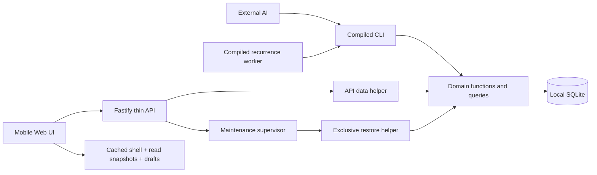

# Implementation Plan: Complete AI Task Manager

**Branch**: `main` | **Feature directory**: `001-ai-task-manager` | **Date**: 2026-10-21
**Spec**: [spec.md](spec.md) | **Constitution**: [v3.0.0](../../.specify/memory/constitution.md)

The setup helper resolves the selected feature as `001-ai-task-manager`; the actual Git
branch remains `main`. No commit, deployment or application implementation is part of this
planning step. The user authorized remaining product decisions and transition to planning.

## Summary

Build one local state engine: SQLite and domain functions in `src/core/`, a compiled CLI for
external agents, and Fastify serving a complete 430px mobile Web UI over the same operations.
Projects independently define priority models and workflows; migration preserves meanings,
dependency checks and audit. Recurrence uses immutable occurrence snapshots, explicit clock
boundaries and exactly-once identity constraints. No accounts or Telegram authentication.

All product choices are resolved in the specification. This plan delivers Phase0 research
and Phase1 data model, contracts and validation guide. Next stage is task decomposition,
not a claim that any executable acceptance check has run.

## Technical Context

| Item | Selected design |
|---|---|
| Language/runtime | TypeScript strict, noUncheckedIndexedAccess, exactOptionalPropertyTypes; Node24.22.0 LTS, npm11.19.1 |
| Dependencies | better-sqlite3/Drizzle, Zod, Commander, Fastify; React/Vite/Tailwind/TanStack Query; server-only Temporal/Markdown/emoji helpers; justified in research.md |
| Storage | Local SQLite WAL, foreign keys, NORMAL sync, busy timeout5000; IndexedDB read cache and separate browser drafts |
| Testing | Vitest with real migrated SQLite, independent-process contention, compiled CLI subprocesses, Fastify inject, Playwright Chromium/WebKit mobile/offline |
| Platform | One Linux host, local filesystem, util-linux flock; API127.0.0.1:3000, dev Vite127.0.0.1:5173 with proxy. Browser HTTPS or localhost for offline shell |
| Product type | Domain engine + CLI + HTTP application + mobile web interface, with supervised recurrence and restore helper processes |
| Workload |20 projects,1000 live tasks,10000 occurrences,50000 audits; diagnostic10000-task/100000-occurrence fixture;4 writers/20 readers |
| Constraints | UI width<=430px, touch>=44px, total emitted JS gzip<150000 bytes; no offline writes, no internal LLM, no public binding or Telegram integration |
| Performance | Constitutional p95 CLI<100ms, query<15ms and build<5s are measurement goals until calibrated; do not turn them into unmeasured release gates |

Dependencies' exact patch versions and native compatibility will be pinned/tested in bootstrap
with a committed lockfile. This is implementation work, not an unresolved architecture choice.
SQLite bundled version must be>=3.51.3 and connection setup checks it. Runtime evidence and
verification scope are documented in [research.md](research.md).

Bootstrap pinning (T001): exact library patches are recorded in `package.json` and
`package-lock.json`. TypeScript 6.0.3 stays within typescript-eslint's declared `<6.1.0`
peer range. Node type declarations follow Node 24. `@fastify/static` supplies local
production asset delivery; it adds a maintained Fastify plugin and file-serving dependency
tree but no browser payload. Its Fastify 5 compatibility is checked before integration.
`workbox-build` and `workbox-window` explicitly satisfy the selected PWA tool's peer
requirements. Native smoke uses `scripts/check-runtime.mjs`; Node 24.22.0/npm 11.19.1
loaded SQLite 3.53.4 and verified the required pragmas on a temporary file.
This is bootstrap evidence only; application/migration checks remain due at T021.

## Constitution Check

Pre-research check: PASS at design level. The requested architecture matches the constitution;
research was needed to choose compatible mechanisms for clock rules, offline shell and audit-
preserving restore. No exceptions were required or assumed.

Post-design check: PASS at design level after reviewing the artifacts below. 'PASS' here means
an explicit compliant design and verification obligation exists, not that tests/lint/build ran.

| Obligation | Planned implementation | Verification / current status |
|---|---|---|
| I — core owns rules/queries, thin adapters | plain core commands/queries; Zod CLI/API boundary; no domain duplication | import rules, CLI/API parity, code review; planned |
| I — standalone engine exclusions | external AI via CLI only; no LLM/Telegram/proxy module | dependency/source review; explicit scope |
| II — unique slug and explicit write scope | immutable unique project slug; ownership before state writes; explicit restore affected-project set | wrong-project and batch ownership tests; planned |
| II — global read visibility | explicit --all-projects, project-first grouping and heterogeneous priority comparison | deterministic fixtures across four models; planned |
| II — atomic immutable audit | state/receipt/audit transaction; allowed actor strings and origin metadata; audit union on restore | rollback/semantic-history/restore tests; planned |
| III — deterministic compiled CLI | Commander adapters, --json, structured stderr errors, explicit version/epoch input | compiled subprocess output/exit tests; planned |
| IV — mobile layout | every screen single max430px column,44px targets | narrow/wide Playwright assertions; planned |
| IV — offline reopening and no writes | shell service worker + read-only IndexedDB hydration, saved times/cache miss and drafts | cold offline reload, eviction and reconnect tests; planned |
| V — functions and dependency direction | schema <- core <- cli/api; web type-only/browser-safe imports | ESLint restricted imports/cycles, no service classes/DI; planned |
| V — type and query/mutation discipline | inferred Drizzle/Zod types, strict flags, synchronous immediate transaction writes, pure queries | typecheck, forbidden any/ignore/non-null rules, query side-effect tests; planned |
| V — cohesive complexity limits | scoped lint limits below; no arbitrary fragmentation | lint and reviewed exceptions only by policy change; planned |
| VI — actual data and migration tests | production migrations on temp DBs; populated upgrade fixtures once prior schema exists | initial prior-release fixture N/A explicitly recorded; no mocked DB/core |
| VI — mutation coverage | success/audit, validation, ownership, rollback, revisions/idempotency | VT01–VT11 traceability; new-project ownership N/A explained |
| VI — real contention | synchronized worker processes/connections, bounded transient lock and exhaustion | test:contention with recorded budget; planned |
| VI — proportional tests/regression | domain clocks injected; real lock barriers; failure regression first | code changes require relevant tests; docs get structural validation now |
| VII — bounded queries/indexes | parent-page then batch relations, justified indexes, cursor read revision and server-selected as_of | EXPLAIN QUERY PLAN fixtures/query-count reports; planned |
| VII — honest performance | declared benchmark profile and goals distinct from gates | commands/runtime/dataset/timings reported; no speed claims yet |
| VII — artifacts/bundle | tsup compiled CLI; native module external; server-only heavy parsers/polyfill | production build + per-asset gzip sum including SW/lazy chunks; planned |
| Stack/tooling | exact Node/npm, locked dependency tree, Fastify/React/Vite/Tailwind/TanStack | native SQLite version/pragma/install smoke; planned |
| Recovery/privacy | scoped maintenance restore, immutable audit, no credential logging/telemetry, exact origin checks | interrupted restore, XSS/origin and log redaction tests; planned |
| Workflow/governance/hooks | tasks must map all obligations, no hook bypass, no inferred merge approval | extension hooks absent; no Git mutation or commit performed |

### Constitution v3.0.0 recheck and verification matrix

The user-authorized 2026-10-21 amendment changes artifact responsibilities, not the required
engineering or acceptance checks. CLI signatures and transport rules are defined in
[contracts/cli.md](contracts/cli.md), [contracts/http.md](contracts/http.md) and
[contracts/common.md](contracts/common.md); human interactions are defined in
[contracts/web-ui.md](contracts/web-ui.md). Exact runtime, storage, schema, process and test
mechanisms remain in this plan, research and contracts. The detailed VT-01–VT-11 engineering
requirements retained below are mandatory and trace to the same observable VT identifiers
in the revised specification. Their implementation and verification owners remain in the
107-task backlog; no test task is removed by the amendment.

The following matrix applies together with the mandatory mutation matrix in
[tasks.md](tasks.md). Every owning test must cover each applicable case; an unlisted N/A
requires a reason here before dependent implementation.

| Operation class | Required verification | Inapplicable coverage and reason | Traceability |
|---|---|---|---|
| New project | Explicit slug/uniqueness, valid configuration and emoji, success/state/audit/receipt, validation, epoch/replay conflict and rollback | Existing-target ownership and revisions of a nonexistent entity are N/A; creation validates explicit new scope and uniqueness instead | FR-002–FR-005, FR-021, FR-025; VT-01/02/05/10 |
| Existing project-owned changes, including configuration, tasks and dependencies | Success plus immutable audit/receipt; input and wrong-project rejection; applicable entity/config/settings/dependency revisions and epoch; exact replay versus changed payload; rollback; historical meanings and graph/emoji/lifecycle invariants | Only operation-specific fields that do not participate in that change are N/A; ownership, audit and rollback cannot be waived for existing project-owned mutations | FR-002–FR-013, FR-021–FR-025; VT-01/02/05/09/10/11 |
| Project update/archive/restore scope | The explicit immutable project slug is both scope and target; require that project's revision/config, reject slug/ID edits and mismatched payload scope, enforce fixed CLI actor scope, and reject changed-scope receipt reuse; archive/restore validate complete child ownership and revisions | A separate wrong-project target UUID is N/A only for these project commands because their contract has no independent target identifier. This does not waive task/occurrence/dependency ownership checks or allow a payload to select another project | FR-002/03/21; VT-02/05; T022/T024/T028 |
| Automatic recurrence | Scoped actor/origin, deterministic injected clock, success plus atomic audit and idempotency receipt for worker and manual tick mutations, operation ID/epoch and applicable parent/config/settings revisions, expiry boundaries, active-period catch-up, unique generation identity, racing ticks and rollback | Interactive confirmation is N/A for deterministic scheduled expiry/catch-up; configured lifecycle transitions retain their own confirmation rules | FR-005, FR-009, FR-011; VT-01/02/04/11 |
| Dependency add/remove | Source task ownership/revision, source project config revision, epoch, separately scoped prerequisite identity, current target category, whole-graph cycle/cardinality validation, audit/receipt/replay and rollback | Caller target task/config revision tokens are N/A because Dependency mutation input defines no such fields; the immediate transaction reads and validates target ownership/category. Settings revision is N/A because ordinary graph changes do not interpret timezone or schedules | FR-003/07/10/17; T037/T041/T047 |
| Ordinary configuration migration | Current config revision supplied as both expected_revision and expected_config_revision, epoch, active owning project, complete changed-task revisions (including archived), exact mappings, projected graph/markers, immutable old semantics, audit/receipt and rollback | Independent project entity revision is N/A because the shared contract explicitly uses config revision for config writes. Settings revision is N/A when no recurrence/timezone-sensitive interpretation occurs; US5 retains the settings guard for schedule-dependent migrations | FR-003/10/17; T036/T042/T047/T077 |
| Direct recurring task lifecycle | Parent/config/settings/epoch, configured edges/confirmation, retirement/open-window invariants and receipt/audit | Recurring TaskTransition, TaskArchive and TaskRestore are alternate entry points to recurrence control and share its required settings guard. Ordinary lifecycle operations remain independent of settings | T067/T068; common lifecycle equivalence |
| Recurring parent content edits | Parent/config/epoch, exact description/emoji/priority validation, immutable existing occurrence snapshots and receipt/audit | Settings revision is N/A for content-only TaskPatch: no schedule/local-time interpretation or deadline derivation occurs. User-authored deadline is rejected; scheduling changes use configure/control with settings guards | T068; common schedule-dependent operation list |
| Occurrence cancellation | Parent task/config/epoch and every selected occurrence revision; paused state, captured absolute deadline, pending-only eligibility, reason, atomic receipt/audit/replay | Settings token is N/A: the common schedule-dependent list excludes cancellation, which neither interprets timezone nor changes schedule rules; stored absolute deadline and current parent state govern eligibility | T059/T066; common mutation preconditions |
| Project lifecycle with recurring children | Project/config/epoch and the exact complete child revision set, captured generation retirement checks, preserved child archive state/reservations, administrative active-to-paused restore and atomic history | Separate settings revision is N/A: these operations use stored absolute conditions; concurrent zone changes invalidate affected child revisions. A restore bypasses child workflow edges/confirmation intentionally, while direct TaskRestore retains them | T069; common project lifecycle contract |
| Recurring configuration migration | Config/entity/epoch and complete affected-task revisions; settings guard when recurring behavior/category changes; immutable prior meanings, pure preview, retirement and projected marker/graph checks | Settings is N/A for label/color/edge-only changes, priority-only changes and same-category status-key mappings because they do not interpret schedule/timezone behavior | T069/T070; common timezone-affecting migration rule |
| Global timezone update | Explicit attribution project config, epoch and expected_settings_revision; fresh transactional validation/versioning of all affected calendar parents and old owed anchors | A separate expected_revision and caller per-parent revision set are N/A: the settings command contract defines expected_settings_revision for the global entity, with no affected-task token payload. Affected parents are read and validated under the same immediate transaction | T060/T070; CLI/HTTP settings contract |
| Queries and history browsing | Correct scope, ordering, filters, cursor/as_of behavior, time boundaries and no state/audit/receipt change | Successful-mutation audit, write receipts and mutation rollback are N/A because reads must be side-effect free | FR-003, FR-005, FR-007, FR-014, FR-016; VT-02/05/09 |
| Backup creation | Consistent verified snapshot under concurrent writes, explicit attribution project, epoch/settings preconditions, compatibility/checksum metadata, external idempotent operation receipt in the snapshot manifest and unchanged domain state/history | Existing-task ownership, domain success audit, domain database receipts and domain rollback are N/A for this operational read-only snapshot; manifest receipt/replay and access/destination validation still apply | FR-022/26; VT-02/03/04/11 |
| Global restoration | Explicit complete union of current/backup project scopes and every affected project entity/config revision (null only for backup-only projects), current epoch, operation ID, settings revision, confirmation assertion/user text, backup/schema/integrity validation, live-connection drain, exclusive external lock, immutable audit/reservation union, conflict rejection, stage/crash rollback, recovery copy, new epoch and external manifest job/operation receipt for lost-response status recovery | Ordinary task-transition edges and task-specific mutation revisions are N/A to the administrative replacement; restore-specific scope/epoch/status and maintenance checks remain mandatory | FR-003/21/22/25/26; VT-02/03/04/11 |
| Rendering-policy cache rebuild | Re-render task and occurrence HTML from the exact preserved Markdown under a valid connection-lifetime lock and one atomic transaction; retain source, frozen occurrence conditions, entity/config revisions, immutable audit and receipts; current policy rebuild is idempotent and never occurs inside a query | Domain success audit/receipt, user confirmation, project attribution and caller revision tokens are N/A because HTML/policy-version columns are derived presentation caches, not user-authored state. Cache invalidation may advance read_revision; source or semantic changes still require ordinary audited commands | FR-005/13/21; VT-01/02/05/06; T023/T026 |
| Released-schema upgrade | Production migrations over populated prior-schema fixtures, preserving work and immutable audit | A prior-release fixture is N/A only for initial schema v1 because no prior schema has been released; add it as soon as a prior released schema exists | FR-004/22; VT-03 |

Use real migrated SQLite, independent synchronized processes for actual contention, compiled
CLI subprocesses, Fastify injection and production mobile/offline browser tests as defined
in the existing technical context, detailed VT requirements and backlog. Keep functional,
contention, browser and benchmark commands/budgets separate. Build, type/lint/boundary checks,
query plans, native compatibility and gzip measurements trace directly to Principles V–VII
and Technical Stack & Operational Constraints, even when there is no matching user action.
The plan's acceptance and measurement sections retain the exact execution budgets and
strict bundle gate. This recheck is design evidence only; executable checks are outstanding.

## Project Structure

### Documentation

```text
specs/001-ai-task-manager/
├── spec.md
├── plan.md
├── research.md
├── data-model.md
├── quickstart.md
├── contracts/
│   ├── common.md
│   ├── cli.md
│   ├── http.md
│   └── web-ui.md
└── checklists/
    ├── requirements.md
    └── planning-readiness.md
```

`tasks.md` belongs to the next `$speckit-tasks` phase and is intentionally not generated here.

### Planned source tree

```text
src/
├── schema/              # Drizzle tables + browser-safe DTO schemas/types
├── core/
│   ├── database/        # connection settings, transaction context, migration entry
│   ├── projects/        # project/config migration, priority/workflow configuration
│   ├── tasks/           # edits/transitions, emoji reservations, dependencies
│   ├── recurrence/      # calendar rules, occurrences, checkpoints, lifecycle
│   ├── queries/         # project-first lists, agenda/statistics, history
│   ├── audit/           # append-only events/semantic snapshots and receipts
│   ├── markdown/        # server-safe rendering
│   └── recovery/        # backup, validation, staged audit-preserving restore
├── cli/                 # Commander commands, worker entry, JSON envelopes
├── api/                 # Fastify routes/hooks, static UI delivery, maintenance status
└── runtime/             # process/lock/supervisor orchestration; no DB queries/rules
web/
├── src/
│   ├── app/             # single-column routes and accessibility
│   ├── screens/         # lists/details/configuration/history/backup
│   ├── data/            # API clients, read-only Query persistence, draft store
│   └── components/      # small form/list primitives
└── public/
drizzle/                  # versioned SQL migrations
scripts/                  # package checks, gzip measurement, benchmark runner
tests/                   # behavior and contract suites
├── unit/
├── integration/
├── contracts/
├── contention/
├── e2e/
└── fixtures/
```

Structure decision: one package with separate browser entry and compiled server/CLI entries.
Transport adapter folders may import core; runtime only orchestrates processes. The HTTP supervisor has no DB/shared lock; its long-lived API data helper owns the connection, validates transport commands and invokes core. No generic
repository/service abstractions. Browser runtime does not import core, SQLite, Markdown
parser, Temporal polyfill or filesystem modules.

## Architecture and key execution paths



**Ordinary write:** validate Zod input, require scope/epoch/revisions, acquire shared external
maintenance lock, open configured SQLite, run immediate core transaction, look up receipt,
validate current state/config/graph, mutate plus audit/receipt, commit, translate response.
Locks and DB lifetimes are coupled. No network/filesystem awaits inside the write transaction.

**Pagination integrity (T052 refinement):** opaque pagination tokens authenticate their
server-selected as_of, offset and context using HMAC-SHA256 with a private random database
secret initialized by a versioned migration. The public database epoch is not a signing key.
Queries only read this secret and never initialize it; the secret is not exposed by resources,
metadata or diagnostics. Persisting it permits independent CLI/API connections to continue
one session. Scope/filter/order/read-revision/epoch changes still require a first-page refresh;
modified tokens are validation errors. Recovery preserves the live signing secret while issuing
a new epoch, so accepted old signed contexts become stale. This internal metadata adds no
caller clock input or query-side mutation.

**Occurrence snapshot refinement (T062/T064):** schedule_generations.schedule stores the
validated Schedule itself. Each occurrence's immutable schedule_snapshot captures
`{generation_id,generation_number,schedule,first_deadline,timezone,miss_policy,confirmation_window_ms}`
with first_deadline as a canonical UTC timestamp. The occurrence's own policy/window columns
remain the authoritative captured classification inputs. This snapshot exposes the historical
zone, anchor and complete generation conditions without consulting mutable current settings.

**Recurring tick:** worker reads due candidates without mutating; builds one explicit scoped
command per project with expected revisions and deterministic tick request context; core
creates unique occurrences/checkpoints and expires windows atomically in bounded batches.
A stale candidate is re-read, never blindly retried. The worker's actor is ai-cli:<slug>,
origin recurrence-worker. Exactly-once outcome comes from database constraints, not worker
singleton assumptions. CLI-only deployments can invoke explicit tick; service startup/timers
provide automatic handling while running.

**Restore:** HTTP supervisor first accepts/validates the job manifest and reports maintenance
status independently of SQLite. It drains requests, stops the API data helper and recurrence children, releases their shared connection locks and starts a restore helper without inherited locks. The HTTP supervisor never owns SQLite or a shared lifetime lock itself. The helper acquires exclusive flock,
validates snapshot/current audit/scopes, builds staged replacement with audit union, permanent project-emoji reservation union and new
epoch, rejects conflicting reservation owners or staged marker collisions, keeps old recovery copy, fsyncs and atomically publishes. Reopen only after validation.
If status response is lost, read status by operation ID; old-epoch restore resubmission still
fails. Crash recovery uses the phase manifest before any normal database open.

## Phase 0 — research outcome

Completed [research.md](research.md): runtime selection verified against official release
metadata; SQLite immediate transactions/version gate; immutable audit and generation-aware
receipts; Temporal calendar rules; read-only offline shell/cache; server-side Markdown
sanitization; Unicode emoji validation; request-origin policy and staged safe restore.

All former Q01–Q19 decisions are resolved under the user's delegation. No technical or product
unknown is left as a clarification marker. Tests are future work, not unresolved design.

## Phase 1 — data model and contracts

- [data-model.md](data-model.md): entities, constraints/index rationale, projected-state
  migration, recurrence algorithm/state machine, epoch/idempotency and restore manifest.
- [contracts/common.md](contracts/common.md): field-level schemas, envelope/error taxonomy,
  mutation preconditions, calendar rules, ordering, archive and recovery contracts.
- [contracts/cli.md](contracts/cli.md): complete commands/flags, JSON streams and agent workflow.
- [contracts/http.md](contracts/http.md): route/method coverage, request/response mapping,
  status codes, exact-origin protection and maintenance endpoints.
- [contracts/web-ui.md](contracts/web-ui.md): screens,44px targets, full operation coverage,
  state/errors, confirmation/emoji conflict/draft handling and offline behavior.
- [quickstart.md](quickstart.md): planned installation, commands and observable acceptance
  scenarios. Commands are not currently available in this documentation-only repository.

## Implementation sequence for task generation

1. Bootstrap pinned toolchain/lockfile, strict types/lint, compiled entries, native SQLite
   setup/migrations, test harnesses, maintenance lock wrapper and minimal shell.
2. Implement core transactions/epoch/revisions/receipts/audit and project configuration
   snapshots before task CRUD, ensuring every write has its invariant/audit tests.
3. Implement priority/workflow/emoji/tasks/dependencies and projected-state migration;
   expose and verify CLI/API parity with migrated SQLite fixtures.
4. Implement recurrence generations/time/policy/window/state machine and supervisor worker;
   verify injected-clock boundaries, repeated ticks, pause/downtime and immutable snapshots.
5. Implement complete mobile screens and APIs, read-only offline shell/cache, Markdown and
   draft retention; measure bundle progressively before additional UI dependencies.
6. Implement manual online backup and exclusive audit-preserving restore, interrupted job
   recovery, browser epoch reset and full operational documentation.
7. Run functional/contract/e2e/contention/build checks and measured query/bundle review;
   compare every acceptance criterion/constitution row to executable evidence before release.

This is an ordering guide, not `tasks.md`; independent UI work can start once contracts and
fixtures exist, but no implementation stage may accept incomplete core ownership/audit tests.

## Validation and performance plan

Planned commands: `npm run typecheck`, `lint`, `test:functional`, `test:contention`, `test:e2e`,
`build`, `check:bundle-size`, `bench`; see quickstart for setup. Functional case timeout10s,
contention case30s with total job180s, browser case30s/job10min, benchmarks separately bounded
at5min. Tune environment startup allowance explicitly rather than shortening SQLite wait.
Domain-time tests use injected clocks; lock tests use process IPC barriers, never blind sleep.

Coverage: FR01–FR26 -> VT01–VT11 -> SC01–SC13, with traceability finalized in task generation.
Every applicable mutation gets positive state/audit and negative validation/ownership/rollback,
including occurrence batches and migrations. New project and read-only operations have the
specific N/A cases in VT02. Backup creation is operational/read-only on domain data; restore
has separate lifecycle/audit tests. No fake mocked SQLite evidence.

Benchmark profile: pinned Linux CI image with4vCPU/8GiB/local SSD-equivalent storage and exact
Node version; save machine/OS/SQLite versions in output. Seed fixed deterministic20-project/
1000-task/10000-occurrence/50000-audit fixture; separate10000-task diagnostic run. Measure
100 cold CLI process invocations,10 warmups+500 list/agenda query samples and10 production
build samples. Report p50/p95/max, startup included for CLI, query row materialization included,
concurrency1 for latency baseline and separate4-writer/20-reader stress. Record deviation and
variance; keep constitutional100ms/15ms/5s figures goals until a baseline supports calibrated
thresholds. No universal test-suite3-second gate.

Bundle gate: versioned Node script gzipSync each emitted web JS asset at level9 and sum bytes,
including service worker and lazy chunks, excluding source maps; require strictly below150000
bytes and fail at or above150000. Missing/unaccounted emitted assets also fail the check. Node/npm/zlib versions are recorded. Keep server-heavy
libraries outside browser imports; dynamic imports improve initial load but do not excuse the
sum budget. Browser asset budget feasibility must be demonstrated during implementation.

Initial lint scopes (reviewable configuration, not automatic fragmentation): application
functions complexity<=12, nesting<=4, parameters<=4 through options objects,<=100 logical lines;
modules<=400 nonblank lines. React components<=150 lines/complexity15; tests<=250 lines per
case/700 per fixture module/complexity20; generated migration output exempt from size limits
but not syntax or migration review. Forbidden type escapes, unsafe casts hiding validation,
cycle/import restrictions and public function contracts apply regardless of size. Policy
changes require rationale and review; no disable comments to conceal failures.

## Privacy, operations and limits

No telemetry or third-party task-text transmission. Logs carry request/operation IDs, scopes,
error codes and durations, not descriptions/confirmation text/full input. Audit intentionally
stores confirmation/content history locally as a user-visible feature. Same-origin checks do
not claim authentication; anyone legitimately connecting has full domain access.

Backups may contain descriptions and history; store them under operator-controlled local
permissions. UI accepts managed backup IDs rather than arbitrary paths. Restore tokens scope
all affected projects and invalidate stale caches. Application crash recovery and power-loss
limits differ under synchronous=NORMAL; do not promise zero-loss recovery absent a verified
backup. No cloud or backup schedule in this release.

## Complexity Tracking

No constitution violations or exceptions are proposed. Recurrence generations, durable
receipts and the maintenance supervisor address explicit user rules and audited recovery;
removing them would break defined behavior. Independent-worker tests, explicit recovery
manifest checks and query/bundle measurements compensate for their implementation complexity.

## Engineering detail relocated from the specification

The 2026-10-21 content correction moves implementation mechanisms and technical history out
of the stakeholder specification without changing the product contract. The original technical
brief and detailed decisions below are preserved for implementation traceability. FR/Q/VT/SC
identifiers in [spec.md](spec.md), [tasks.md](tasks.md) and the existing contracts retain their meaning.
These records originated in the earlier content-only correction. Constitution v3.0.0 now
supersedes the former artifact-placement requirement; the engineering obligations below
remain mandatory. Spec Kit command rules are unchanged.

### Original technical brief

Build a complete SQLite core, Agent CLI, Fastify API, and 430px mobile-only Web UI without authentication in this release. Projects independently configure priority models and workflows. Use exact deadlines, a dedicated recurring/maintenance flow, and task-description-contained AI explanations and plans. Telegram authentication is a future release. Human conversation is Russian; repository artifacts are English.

### Resolved Decision Register

All entries below are settled under the user's explicit delegation. Technical mechanisms are expanded in the implementation plan; no further clarification approval is required.

- **Q01 — Priority expressiveness (resolved)**: Custom numeric bounds are inclusive within -1,000,000,000..1,000,000,000 with at most three decimal places; min < max and explicit higher/lower direction. Store exact thousandths, reject rather than round invalid input. Custom named levels have stable keys and distinct ordered ranks. Classic values and Eisenhower flags are fixed.

- **Q02 — Ordering (resolved)**: Project priority is signed 32-bit integer, default 0; duplicates allowed, explicit null rejected. Reset by setting 0. Slug ordering is ASCII lexical and IDs lexical. Preserve the agreed project-first and within-project priority/deadline/creation/ID sort in every paginated list.

- **Q03 — Configuration defaults (resolved)**: Names and optional colors are configurable for custom levels and all statuses. Colors use palette tokens slate/red/orange/amber/green/teal/blue/indigo/violet/rose and never carry meaning alone. Built-in presets only in release one; no saved reusable custom presets. Classic level meanings and Eisenhower axes are not editable. Initial status is one project-configured status in not_started/draft behavior, not arbitrary direct creation in completed.

- **Q04 — Workflow presets (resolved)**: Ordinary states idea/planning/ready → not_started, in_progress → in_progress, sanity_check → review, done → completed, cancelled → cancelled. Forward six-state chain, all five adjacent backward edges including done → sanity_check, done → in_progress, unfinished → cancelled, cancelled → idea. Initial idea. No blocked status: unmet dependencies are a computed indicator. Recurring initial draft; draft → active/archive, active → paused/archive, paused → active/archive, archive → paused. All recurring statuses map to exactly one lifecycle behavior; configure one explicit restore-status key in paused, default paused, to resolve multiple custom paused labels. Archival conditions always apply.

- **Q05 — Confirmation and categories (resolved)**: Default only sanity_check → done requires confirmation. Users may change it per edge. No arbitrary guard expressions beyond dependencies, revisions, confirmation and lifecycle rules. The agent supplies confirmed=true plus nonempty user-confirmation text for that precise mutation; an idempotent retry is the same operation, otherwise renewed assertion is required. Human UI confirmation submits explicit consent text. Completed/cancelled are not current workload; completed counts in completion history, cancelled is separately filterable.

- **Q06 — Migration semantics (resolved)**: Rename preserves stable status/level key and task association. Removing values or switching models requires explicit mapping; no inferred priority conversion. Category changes are explicit configuration migrations with validation over the complete resulting state and dependencies. Only new ordinary transitions use edited edges; existing tasks do not move automatically. Config revisions and historical before/after semantic snapshots keep history readable. Dependency satisfaction is validated against the complete projected state for ordinary tasks whose status ID or category changes into in_progress/review/completed. Unchanged advanced dependents, including other projects, may remain blocked when a prerequisite is mapped out of completed; they do not cause rejection or automatic status changes. Label/color/edge-only or priority-only edits do not count as status transitions; graph integrity and other invariants remain enforced.

- **Q07 — Recurring lifecycle (resolved)**: Maintenance and recurrence are one kind. Paused means no newly arising periods; existing precreated occurrences continue. Record active/pause intervals so downtime catch-up excludes pauses. Archive is blocked by pending/debt occurrences or unprocessed owed active-period anchors; project archive validates every child first, preserves task states, and makes project read-only. Project restoration leaves formerly active recurring parents paused, preserving draft, already-paused and individually archived children and ordinary statuses. Moving active children to the configured paused status is an explicit project-restoration effect, bypasses individual transition edges/confirmations, and audits every changed child. Calendar resume creates next future anchor and keeps preexisting occurrences. Completion-relative resume keeps existing open occurrences; if none and the derived next deadline elapsed during pause, explicitly supply a new first deadline to start a new schedule generation, without inventing completion. Within a generation all later deadlines remain actual completion + interval.

- **Q08 — Occurrence mechanics (resolved)**: Require policy and integer confirmation window 0..30 days in milliseconds. Timely iff recorded_at <= deadline+window; expiry iff now > that endpoint. Actual completion may be past but not future; completion-relative actual times must not precede previous actual completion in that generation. States: pending, completed, completed_late, debt, missed, cancelled. Pending expires to debt/missed. Pending/debt/missed can complete; expired ones become completed_late, with original miss audit preserved. Completed states cannot reopen in release one. Pending future occurrences of a paused parent alone may be cancelled with a reason; debt cannot be cancelled. Completion-relative missed waits for late actual completion before another occurrence. A worker ticks on startup and every 30 seconds; CLI also offers explicit tick. Catch up all active-period calendar anchors in resumable batches; unique generation/anchor identity prevents duplicates. Configuration changes affect only not-yet-created occurrences.

- **Q09 — Schedule and display (resolved)**: First deadline explicit; calendar every N days/weeks, selected weekdays, every N months at a specified month day, clamp to month end. N is positive integer <=3650; completion-relative duration is positive integer hours/days within the same bound. Create initial occurrence on activation; materialize calendar anchors due through now and one next future anchor, retaining all previously created occurrences. Overlapping windows/debts are allowed. A changed calendar schedule has an explicit new first anchor/generation; existing records persist. Changing timing mode requires no pending/debt occurrence, then a new explicit first deadline. Calendar DST gap shifts forward by gap, fold uses earlier instant; ordinary ambiguous user input is rejected. Parent displayed deadline is earliest pending/debt deadline, otherwise null, and is read-only.

- **Q10 — Time contract (resolved)**: Accept RFC3339 date-time with explicit offset, at most millisecond precision; emit UTC ISO strings with exactly three fractional digits. UI local input uses configured IANA timezone; reject ambiguous/nonexistent entered local times until user selects an unambiguous offset/time. Past ordinary/first deadlines are permitted, displayed as overdue when applicable. Completion-relative hours/days mean elapsed durations (day=24h), calendar days preserve wall time. Timezone change preserves every stored deadline instant; future uncreated calendar anchors use the new zone with the same local rule, audited as a new schedule version. Date-only input and scheduled_for are rejected.

- **Q11 — Views and metrics (resolved)**: Active lists exclude archived/cancelled/completed by default, with explicit filters for each. Search is case-insensitive substring over title and Markdown description; filters include project, kind, status/category, priority, emoji and archive state. Page size50, maximum200, stable cursor includes filter/sort/revision context and a server-selected as_of instant. Paginated domain reads freeze overdue/calendar classification at that instant across pages and expose meta.as_of separately from request-time meta.now. Time passing alone does not invalidate a cursor; a fresh first-page refresh captures a new as_of. No caller clock override is accepted. Changed data/query context returns CURSOR_STALE and requests refresh. Agenda per project: overdue, today, next7 calendar days excluding today, later, no deadline, in that order. Recurring parent displayed once with earliest pending/debt deadline, not an editable parent deadline. Separate counters: unfinished/overdue/completed ordinary tasks and pending/debt/missed/completed occurrences; optional from/to bounds apply to deadlines for workload and recorded completion time for completion counts. Ranges are half-open [from,to): omitted bounds are unbounded, equality produces an empty range, reversed bounds return VALIDATION_ERROR, and null filtering timestamps are excluded when either bound is present. With no bounds undated tasks remain in applicable workload counts. Statistics use one server-selected as_of per request and return it in metadata. Cancelled and archived excluded unless requested.

- **Q12 — Lifecycle, links, emoji and limits (resolved)**: Archive is a flag for ordinary tasks/projects, lifecycle behavior for recurring parents. No deletion/move/slug rename. Archived records read-only; restoring ordinary task preserves status and rechecks emoji/dependency invariants. Archived completed prerequisites satisfy; archived unfinished ones do not. Dependency add/remove requires dependent task scope/revision, graph validation and audit; cannot add unmet prerequisites when dependent is in progress/review/completed. Emoji is one Unicode RGI emoji grapheme (ZWJ/tone allowed); normalize presentation selectors for uniqueness, preserve display text. Project and task emoji may be explicitly changed subject to reservations; past project emoji remain permanently reserved to that project, including across backup restore. Restore unions live and backup reservation keys with their original project_slug owners, retains historical owners even if absent from restored projects, and rejects conflicting owners/staged markers with EMOJI_CONFLICT instead of releasing reservations or rewriting history. Task markers on recurring draft/active/paused parents reserve; occurrence completion never releases the parent marker. Emoji lookup is a filter returning matching tasks, not a unique selector; mutations use technical IDs. Limits: slug1..64 lowercase ASCII letters/digits/hyphens, title1..300 characters, description<=100000 characters, names1..80; 100 statuses, 100 named levels, 100 prerequisites per task, validated request body<=1MiB except backup transfer.

- **Q13 — Description (resolved)**: Free-form CommonMark subset: paragraphs, emphasis, headings, lists, links and fenced code. Raw HTML and executable URLs disabled; images are not rendered in release one. UI edits source and displays safe rendering; CLI/API preserve source exactly. No mandatory structure, attachments or rich editor. Replace full description with revision protection; every occurrence snapshots source and its safe-rendered representation at creation.

- **Q14 — Audit access (resolved)**: UI and CLI browse immutable before/after history, including confirmation text and original workflow/priority meanings. No separate audit export. Automatic recurrence records ai-cli:<slug> with origin recurrence-worker; it is deterministic processing, not an LLM action.

- **Q15 — Access and origins (resolved)**: No authentication. Fastify127.0.0.1 serves same-origin UI/API; configured exact public origin is an operational setting for external TLS routing owned outside this repository. Enforce configured Host and Origin, no wildcard CORS; browser writes require JSON plus a custom mutation header, reject cross-site fetch metadata. Same-origin Web UI only is the supported HTTP client; external automation uses CLI. No identity-based authorization is implied.

- **Q16 — Interface coverage (resolved)**: All agreed operations in UI and CLI; API supplies UI routes. Command names, required arguments, DTOs/errors, scope, revisions and examples are normative in contracts/cli.md, http.md and common.md. Global settings CLI uses an explicit project context for ai-cli actor attribution; global restore explicitly names all affected project slugs. Protocol version /api/v1. No public third-party API actor or token integration in release one.

- **Q17 — Offline (resolved)**: Persist application shell and fetched task/priority/descriptions; reload/reopen works after successful online caching. All writes and queues disabled offline. Show saved-at time and cache misses; reconnect refetches while retaining separate editor drafts. Database epoch mismatch discards stale query cache, never unsaved draft text. Browser cache retention is best effort: quota/eviction is an explicit missing-cache state, not a promised backup.

- **Q18 — Conflicts and retries (resolved)**: Require operation UUID, database epoch, expected entity revision and affected project config revision where applicable. Check dependency/schedule settings revision within the same transaction. Same operation+canonical payload replays original result before ordinary stale revision checks; changed payload conflicts. Old database epoch always rejects, including retries, so restored state cannot receive an old request. Description proposals remain local/input-file text; no hidden server-side draft system or auto merge. Successful receipts persist without time-based expiry in release one.

- **Q19 — Operations (resolved)**: One Linux host with local filesystem, Node24 LTS, one API service plus compiled per-project recurrence worker/CLI processes. No network SQLite filesystem or horizontal deployment. Manual full backup/restore only, preserving settings/audit and recovery copy. Restore drains connections, validates stage, unions immutable audit and permanent project-emoji reservations, rejects reservation conflicts before publication, atomically publishes new generation under exclusive external maintenance lock; normal restore refuses unreadable current audit. UI status remains available during maintenance. Workload fixture:20 projects,1000 live tasks,10000 occurrences and50000 audit events; larger diagnostic fixture10000 tasks/100000 occurrences, four writer processes and20 read clients. No guessed performance SLA: constitutional latency/build targets remain measured goals; gzipped emitted JS must be strictly below150000 bytes; equality fails the gate. With WAL+NORMAL, power loss may lose recent acknowledged transactions; backup recovery point is the last verified manual copy, not zero data loss.

### Required Verification

- **VT-01 — Domain behavior**: Verify FR-002–FR-014 and resolved Q01–Q13 using all priority models, configured workflow edges/defaults, confirmation text, ownership, mappings, semantic audit history, dependency enforcement, deadline/zone boundaries, all recurrence modes/policies, pause/archive/restore, snapshots and selected debt completion. Use injected time; no real sleeping for domain time.
- **VT-02 — Mutation applicability**: Every domain mutation needs success+audit, validation, atomic rollback and idempotency checks. Existing project-owned entities need wrong-project rejection. New project creation instead needs explicit slug/uniqueness; reads must be side-effect free and have no success-mutation audit. Backups are read-only snapshots; restore is a separate scoped administrative mutation. Document any other N/A.
- **VT-03 — Real persistence and migration**: Use real SQLite with production migrations; verify reopen, constraints and audit persistence. When prior schemas exist, upgrade populated fixtures preserving history. Initial release records absence of a prior released schema rather than claiming such coverage.
- **VT-04 — Contention**: Use independent workers/processes with separate connections to the same file, barriers, bounded waits, transient lock success and lock-timeout DB_CONFLICT. Verify state/audit/receipt atomicity, racing emoji assignment, dependency cycles, recurrence ticks and restore maintenance locking. A single-threaded Promise.all is not evidence.
- **VT-05 — CLI/API contracts**: Verify stdout/stderr/nonzero failures, every command --json, explicit scopes, all command/route pairs, errors, time/ordering, revisions/epoch/idempotency, and exact state round trips. Fastify tests use inject(); no mocked core or database substitutes.
- **VT-06 — Mobile/offline**: Verify <=430px width at narrow/wide viewports, >=44px targets, full operation coverage, copyable emoji, Markdown source/safe rendering, conflict drafts, cached shell offline reload, cache miss/eviction, disabled writes, reconnection and epoch refresh. Verify same-origin request handling and no login/Telegram dependency.
- **VT-07 — Build and governance**: Typecheck strict flags, lint/module boundaries and complexity policies, build native/compiled CLI and browser separation. Verify SQLite pragmas/version, lockfile and migrations, hook behavior, no secret logging and every constitution obligation in plan traceability. No implementation-only checks are claimed at planning time.
- **VT-08 — Measurement honesty**: Separate functional/contention/benchmark commands and timeout budgets; record commands, exit/duration and pending checks. Specify machine/runtime/dataset/percentile/cold-warm/tolerance for latency goals. Sum individually gzip-compressed emitted JS including lazy/SW chunks, excluding maps, with reproducible settings; gate at150000 bytes.
- **VT-09 — Dependency graph**: Same/cross-project ordinary tasks, multiple prerequisites, custom labels, cancelled/archived cases, rejected self/cycles, adding unmet links to advanced tasks, reopening prerequisite without rewinding dependents, migration final-state validation and recurring endpoint rejection.
- **VT-10 — Emoji rules**: One RGI grapheme validation, selector normalization, task-scope uniqueness and release, repeatable ⚪, no random assignment, global permanent project reservations, collision return behavior and concurrent assignment rollback.
- **VT-11 — Edits and recovery**: Human-first/agent-first stale saves including disjoint text; proposals retained; no merge. Config/dependency changes revalidated atomically. Lost-response replay no duplicate audit. Backup under concurrent writes, restore blocked by live connections, staged failure/crash recovery, audit union, old epoch refusal and fresh offline cache identity.

### Key Entities

- **Project**: Stable ID/slug, global emoji reservation, numeric priority, configuration revision and archive state.
- **Priority and Workflow Configuration**: Versioned per-project models, status categories/lifecycle mappings, edges, initial states and confirmation flags; historical meaning snapshots retained.
- **Task**: Stable ID, project ownership, kind, emoji, title/Markdown, priority, status, optional ordinary deadline, revision and archive state.
- **Dependency**: Directed ordinary-task prerequisite link, graph checked inside the transaction; endpoint IDs and owning dependent project explicit.
- **Recurring Schedule Generation**: Parent ID, mode, explicit first anchor, immutable rule version, configured policy/window and active/pause intervals; generation records are retained after reconfiguration.
- **Occurrence**: Parent and generation identity, unique anchor/predecessor key, immutable deadline/policy/window/description snapshots, mutable outcome, recording/actual completion times, revision and miss history.
- **Audit Record**: Immutable UUID, allowed actor plus origin, scoped entity, before/after payload and semantic snapshots, request ID/time/generation; no foreign key forcing a current entity to exist after restore.
- **Operation Receipt**: Epoch/scope/actor/operation key, request fingerprint and committed result for durable idempotency.
- **Application Settings and Database Epoch**: Shared timezone, operational origin, schema/version identity, generation and settings revision.
- **Offline Snapshot and Local Draft**: Cached server query state scoped by epoch, saved time and loaded descriptions; unsaved editor text kept separate, never an offline write queue.
- **Backup and Restore Manifest**: Verified snapshot metadata, checksum/schema/source epoch, affected scopes, stage/previous/new generation identifiers and crash-recovery phase.

### Planning review refinements

- Retirement (task/project archive or equivalent configuration migration) requires recurrence catch-up through all owed active-period anchors before evaluating pending/debt guards. Pause preserves the processing of anchors owed before pause; it excludes only anchors arising during paused intervals.
- Only actual completion belonging to the current completion-relative generation can create a successor. Completing a historical generation changes its occurrence/history only. Initial draft activation may seed an explicitly past first deadline. An active explicit schedule restart requires a future first deadline. Calendar resume skips elapsed paused-period anchors; a deferred completion-relative seed that elapsed while paused requires a replacement future first deadline. Timezone versions continue from their cursor without reseeding historical first deadlines. Existing records never change.
- A schedule-generation change must first reconcile owed anchors of the old generation through its effective change time. The worker may continue that old catch-up after pause, but no generation switch or retirement may drop it.
- Schedule-dependent writes also carry the expected application-settings revision, rejecting timezone races. Project archive/restore carries expected revisions for all child tasks it affects; all are checked atomically.

### Original detailed functional constraints

The following wording preserves the original interface and persistence detail behind FR-001–FR-026.
The stakeholder-facing specification expresses the same outcomes without choosing mechanisms.

- **FR-001 — Complete product boundary**: Deliver SQLite core, compiled Agent CLI, Fastify API, and mobile-only Web UI over the same business rules. No internal LLM orchestration, Telegram bot/authentication, reverse-proxy routing, desktop layout, or offline writes.
- **FR-002 — Projects and tasks**: Create, read, edit, archive and restore projects/tasks. Unique immutable project slugs and technical task IDs remain distinct from emoji. No permanent deletion or cross-project task moves. Archive blocks ordinary editing except restoration and audit reads; explicit configuration migration may remap archived task values while the owning project is not archived; recurring archival requires no pending/debt occurrences.
- **FR-003 — Project-scoped mutations**: Every project-owned mutation requires explicit project_slug; an existing task in another project fails PROJECT_MISMATCH. Multi-project restore requires the explicit complete affected-slug set. Aggregate reads use --all-projects.
- **FR-004 — Durable atomic state**: Commit state, revision changes, idempotency receipt and immutable audit together. Rejection leaves all unchanged. Use real SQLite migrations and consistent per-connection settings; process-crash durability must not be confused with zero-loss power-failure guarantees.
- **FR-005 — Audit history**: Append actor, origin, time, entity, before/after fields and semantic configuration snapshot atomically. Actors are human-web or ai-cli:<project_slug>; automated recurrence uses the latter with recurrence-worker origin. Confirmation-required agent actions record assertion and user text. Browse through UI and CLI; no audit export or modification/deletion of audit records.
- **FR-006 — Project priority models**: Classic critical/high/normal/low, independent importance/urgency Eisenhower flags, custom ordered named levels or bounded numeric scale with configured direction. No formulas/multi-axis custom schemes. New project defaults classic; task priority defaults unset. Q01–Q03 define precision and customization.
- **FR-007 — Cross-project ordering**: Group by descending project numeric priority then slug; default project priority 0. Within a project order by model importance, unset last, deadline ascending missing last, creation time then task ID. No universal task-priority conversion.
- **FR-008 — Default ordinary workflow**: Supply the six forward states plus cancelled and the transitions/categories in Q04. Initial status configurable, default idea. Default sanity_check → done requires human confirmation.
- **FR-009 — Custom workflows**: Ordinary statuses each map to exactly one shared category; recurring statuses each map to draft/active/paused/archived behavior. Projects configure directed transitions and per-transition confirmation. Ordinary edits require a configured edge; explicit FR-010 migration is the exception. Agent confirmation includes both assertion and user text for that one operation, with no Web UI approval prerequisite.
- **FR-010 — Configuration migration**: All invalidating changes require complete old-to-new mappings. Commit configuration, tasks and audits atomically; mapped changes bypass ordinary edges and their confirmations, never dependency checks. Preserve historical labels/categories/priority meanings. Renames preserve identity; category changes validate all affected tasks; transition edits affect future requests only.
- **FR-011 — Recurring work**: One persistent recurring/maintenance parent contains occurrence records. Support independent calendar/completion-relative modes and carry-forward/record-miss policies. Require explicit first deadline, policy and window. Apply exact rules in Q07–Q09; snapshot description/settings per occurrence. No synthetic actual completion, no debt forgiveness, no paused-period catch-up.
- **FR-012 — Exact deadlines**: Optional removable ordinary deadline; every occurrence has an exact deadline. No scheduled_for field. One configurable timezone default Europe/Moscow controls input/display and calendar recurrence. Ordinary overdue means now strictly past deadline outside completed/cancelled. Q10 defines transport and DST rules.
- **FR-013 — Description and plans**: Use free-form Markdown without mandatory sections; AI explanations and plans reside inside it. No internal content generation. Whole-description replacement is supported with stale-version protection; no structured section patch API. Occurrences retain description snapshots. Preserve submitted text on conflict.
- **FR-014 — Read visibility**: Single-project and aggregate lists/agendas/priority/workload views with deterministic filters/search/pagination. Q11 defines groups and counters. Use status categories, not labels; count ordinary tasks and occurrences separately.
- **FR-015 — CLI automation**: Non-interactive commands with --json; clean JSON success stdout; structured failure stderr and nonzero exit. Stable baseline errors: VALIDATION_ERROR, TASK_NOT_FOUND, PROJECT_NOT_FOUND, PROJECT_MISMATCH, DB_CONFLICT. Detailed signatures are defined in contracts/cli.md.
- **FR-016 — Deterministic contracts**: Document input/output ordering, time representation, revisions, request IDs, epoch and errors in contracts/. Equivalent CLI/API actions use the same core. Reads never trigger domain mutations.
- **FR-017 — API behavior**: Fastify listens on 127.0.0.1; serves the Web UI and its domain operations. UI-origin requests use human-web. Current-release external automation uses CLI, not an additional API actor. Browser-origin protections in Q15 do not introduce identity authentication.
- **FR-018 — Mobile interaction**: Every agreed user operation is available in UI and CLI. Single column width100%, max430px, centered; targets >=44px. Include project configuration/migrations, recurrence, dependencies, emoji, description editing, archive/restore, history, backups and recovery. Russian UI copy; repository artifacts and protocol field names English.
- **FR-019 — Offline reads**: Cache shell and latest loaded data/descriptions after successful online opening; support offline reload/reopen. Show offline/last refresh/missing-cache context; disable writes and never queue them. Reconnect refresh preserves unsaved text; changed epoch forces cache invalidation with drafts retained.
- **FR-020 — Unauthenticated access**: Anyone who can connect may use current read/write operations without accounts, login, credentials or identity permissions. Domain rules, explicit scope and configured confirmations still apply. Telegram authentication remains outside this release.
- **FR-021 — Conflicts and retries**: All writes carry expected entity/configuration revision and database epoch where applicable. Reject stale writes atomically, retaining proposals. Idempotent identical mutation retries return the original committed result; reused operation IDs with changed content conflict. No last-write-wins or automatic description merge.
- **FR-022 — Recovery and compatibility**: Versioned migrations preserve data/audit; breaking contracts document upgrade and rollback. First schema has no prior release to upgrade and must say so. Manual full backup/restore follows FR-026 and Q19.
- **FR-023 — Task dependencies**: Directed ordinary-task prerequisites can cross projects. Only completed satisfies; cancelled does not. All unmet prerequisites block entering in_progress/review/completed. Reject self-links/cycles and recurring/occurrence endpoints. Dependency changes never automatically move statuses; adding unmet prerequisites to already advanced tasks is rejected.
- **FR-024 — Task emoji**: Meaningful one-emoji markers selected by human/external AI; no random assignment. ⚪ is repeatable default. Non-default markers unique among unfinished nonarchived tasks per project and not reserved by any project. Completion/cancellation/archive releases reservation; return conflicts request choice where supported, else ⚪. Visible in list/detail and copyable as ordinary text.
- **FR-025 — Project emoji**: Project creation requires a meaningful globally exclusive emoji; ⚪ prohibited. Reservation includes archived projects and historical project markers and can never be assigned to tasks or other projects. Reject a new project marker already present on any task rather than rewriting task history.
- **FR-026 — Manual backup and restore**: Provide full database/settings backup and maintenance-mode restore through UI and CLI. No cloud or automatic schedule. Validate backup integrity and compatible schema. Keep a pre-restore recovery copy; union immutable readable audit by UUID; reject divergent audit collisions; issue a new epoch. Explicitly scope every affected project. Never replace a database with open connections or discard WAL. If current audit is unreadable refuse normal restore and preserve damaged files.

### Command interface summary relocated under constitution v3.0.0

All three interfaces are affected. The normative full command table is [contracts/cli.md](contracts/cli.md), with common payload/revision/time rules in [contracts/common.md](contracts/common.md). Primary groups are `ai-tasks project`, `config`, `task`, `dependency`, `description`, `recurrence`, `occurrence`, `audit`, `settings`, `backup`, and operational `serve`/`worker run`; aggregate queries are `agenda`, `priorities`, and `stats`. Reads require `--project <slug>` or `--all-projects` where aggregation is supported. Project-owned writes require `--project <slug>`, structured input, operation UUID and epoch, and applicable expected revisions. No command prompts interactively. Every command supports `--json`.

Detailed API and mobile interaction contracts are [contracts/http.md](contracts/http.md) and [contracts/web-ui.md](contracts/web-ui.md). Command signatures and schemas are settled planning outputs under the delegated decision authority, not unanswered product questions.

**Logical miss timestamp refinement (T065/T066):** missed_at is the captured expires_at boundary, assigned only when now > expires_at and retained by late completion. Equality remains timely/pending. Audit timestamps use the actual injected recording clock, keeping logical expiry distinct from worker delay.

**Completion-relative equal-actual refinement (T066):** nondecreasing actual timestamps permit equality. Distinct elapsed successors identified by after:<predecessor_occurrence_id> may therefore share a deadline with already completed history. Calendar anchors and explicit generation restart seeds retain parent-wide deadline collision rejection. This follows the common contract's calendar-anchor collision rule and preserves the explicit equal-actual completion requirement; no actual completion is synthesized.

**Recurrence mutation result refinement (T065/T067/T071):** tick returns generated_ids and expired_ids plus affected_tasks revisions, bounded progress/has_more and processed task_ids. Configuration mutation returns revised frozen generation settings with task_id and parent revision. Lifecycle control returns parent detail with its current recurrence configuration. Captured occurrence-event audit context remains the frozen schedule snapshot; parent summary audit retains the current project configuration meanings.

**Timezone continuation activation (T070):** a draft whose calendar generation was versioned solely by a timezone change retains the continuation checkpoint. Later activation follows that checkpoint's strictly future candidate instead of running the initial-seed path against the historical first_deadline. A fresh initial generation remains eligible for the explicitly supplied past seed.

**Timezone mutation details (T070):** the explicit project supplies actor/configuration attribution, including when that project is archived; global settings do not edit its archived content. A same-zone accepted write increments settings/read revisions and records audit without creating redundant schedule generations. Calendar parents across all projects/states are versioned and their revisions increment, while elapsed schedules and ordinary deadlines remain unchanged. Archived projects never gain active recurrence intervals. Old-zone reconciliation includes due anchors at the effective instant, creates no new old-generation future row, and shares a128-step budget across the global command; any remaining work rejects the entire transaction with explicit tick guidance. The unresolved next candidate carries calendar cadence independently of a continuation cursor's effective-time floor: re-express its old-zone civil date at the unchanged local rule time in the new zone, then seek strictly after the effective time, prior cursor and maximum materialized deadline across all parent generations/outcomes. Historical pending/completed/cancelled future rows still define that instant horizon; unmaterialized first deadlines do not. Repeated timezone changes while paused/draft retain that cadence. Full parent descriptions are processed in32-row keyset pages inside the same atomic transaction.


### US4 implementation refinement (T078/T082)

Persist an internal nullable ordinary completion recording time with a versioned migration.
The existing task row has no such fact, and immutable audit union after restore can retain
ambiguous branches with matching task UUID/revision. T078 tests the fact through real
transitions/configuration mappings, preservation, replay and rollback before implementation;
T082 adds storage/writer integration alongside statistics. Existing migrations and public
Task payloads remain unchanged. The [data-model refinement](data-model.md#us4-implementation-refinement--ordinary-completion-recording)
defines its null/backfill semantics. Statistics include completed outcomes by default and
exclude cancelled/archived work unless requested; they apply deadline and recording-time
bounds separately rather than filtering all metrics through a parent deadline.
